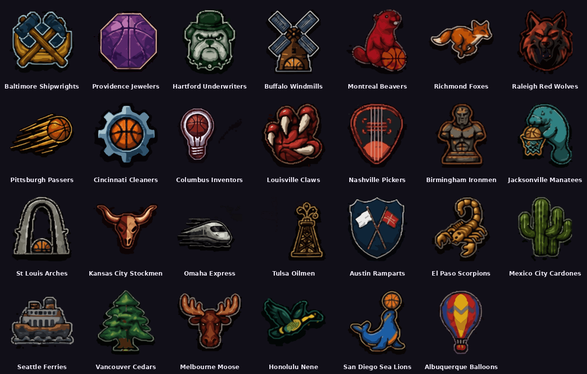
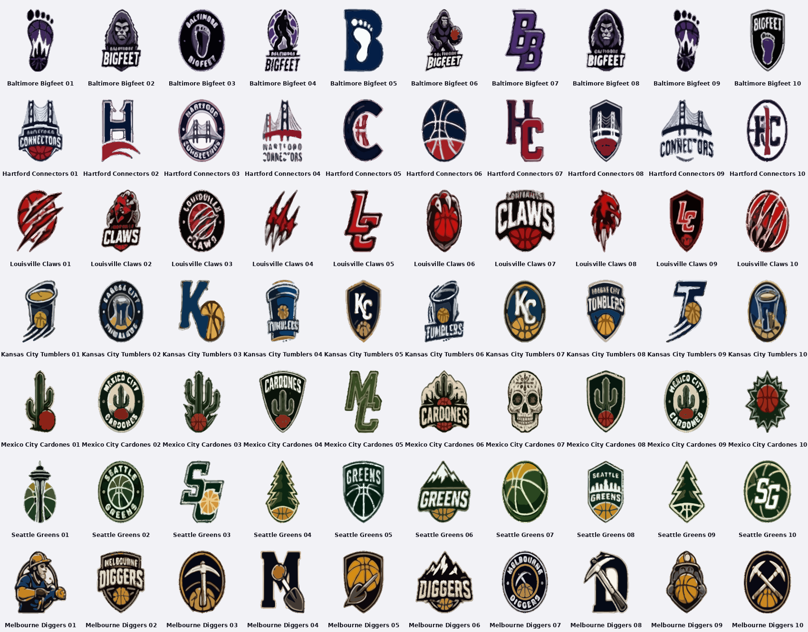

# LSP logos

Logos for **LSP – Logo Styler Picture** (`../lsp.html`). Every file is a `.lsp` project, so it stays editable. To open one, open `lsp.html` in a browser, choose **Open .lsp** and pick the file.

## originals/: the league sheets, traced

The two league sheets were cut into single logos (`tools/extract_logos.py`) and traced into vector color layers (`tools/trace_logos.py`):

- `originals/vbl/`: the 27 Vintage Basket League icons
- `originals/<team>/01–10.lsp`: the ten concepts for each of Baltimore Bigfeet, Hartford Connectors, Louisville Claws, Kansas City Tumblers, Mexico City Cardones, Seattle Greens and Melbourne Diggers

The same 97 logos are in the LSP library under **Art**, grouped as **VBL league icons** and **<team> concepts**. The library is loaded from `../lsp-library.js`. In LSP, **Content → Colors** switches a traced logo between its original colors, shading in the fill color of your choice, and a plain silhouette.





## rebuilt/: hand-built versions

`rebuilt/` holds the same logos rebuilt from LSP's own shapes, art, fonts and effects (`tools/make-logos.js`). They are simpler, but every part is a separate layer you can edit.

## The .lsp format

A `.lsp` file is UTF-8 JSON:

```json
{
  "format": "LSP", "version": 1, "app": "Logo Styler Picture", "name": "Austin Ramparts (VBL)",
  "canvas": { "bg": "none", "bgC": "#1b1530", "pixel": 9, "crop": true, "size": 1024 },
  "layers": [
    { "id": "l1", "type": "shape", "name": "Heater shield",
      "x": 500, "y": 500, "rot": 0, "sx": 3.3, "sy": 3.3, "skew": 0, "visible": true, "locked": false,
      "p": { "k": "heater" },
      "s": { "fill": "linear", "c1": "#2a4a70", "c2": "#14263f", "o1c": "#e8e8ee", "o1w": 5 },
      "clip": { "t": "", "m": "in", "gap": 0 } }
  ]
}
```

- `layers` are listed bottom to top on a 1000 × 1000 canvas.
- `type` is one of `shape`, `clip` (art), `text`, `ring`, `lines`, `image` or `svg`. `p` holds the parameters for that type. For example, `k` names a library art key.
- Art that is not built into LSP travels inside the file as `p.art`:
  - `d`: silhouette path, used for fill, outlines, depth and clipping
  - `dd` and `d2`: detail fills
  - `ds`: detail lines
  - `parts`: color layers, as `[color, path]`
  - `e: 1`: use the even-odd fill rule
  - Paths use a −100…100 box.
- `s` is the style. LSP fills in defaults for missing keys and checks every value when it opens a file.
- `clip.t` names another layer's `id`. `clip.m` is `in` to show the layer only inside that layer, or `out` to cut that layer out of it.
- PNG and SVG images exported from LSP carry the same data (a PNG `tEXt` chunk `LSP`, an SVG `<metadata id="lsp-data">`). LSP opens them again for editing.

`../docs/use-ai-ohje.md` explains how to have use.ai (or another AI) make new objects that import straight into LSP.

## Rebuilding

```
python3 tools/extract_logos.py vbl <league sheet> crops/vbl
python3 tools/extract_logos.py concepts <concept sheet> crops/con
python3 tools/trace_logos.py crops/vbl 10 traced_vbl.json
python3 tools/trace_logos.py crops/con 8 traced_con.json
python3 tools/build_library.py traced_vbl.json traced_con.json   # writes lsp-library.js
node tools/make-original-lsp.js                                   # writes logos/originals
node tools/make-logos.js                                          # writes logos/rebuilt
```

Needs Python with `numpy scipy pillow potracer`, plus Node with Playwright.
